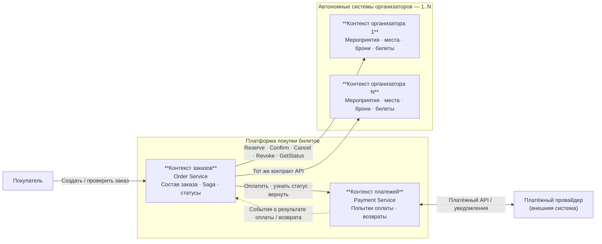

# 01. Карта контекстов

**Проект:** Микросервисная платформа покупки билетов независимых организаторов с распределённым бронированием и компенсацией частично выполненных заказов.

**Статус:** версия 1.0 — архитектура, без реализации.

## 1. Постановка задачи и границы системы

Пользователь составляет **один заказ из одной или нескольких позиций**: билеты могут относиться к одному мероприятию, нескольким мероприятиям одного организатора либо мероприятиям различных организаторов. Число мероприятий, билетов и организаторов не фиксируется архитектурой. Организаторы — юридически и технически независимые участники: каждый самостоятельно управляет мероприятиями, доступностью мест, временными бронями и выпущенными билетами, продаёт билеты также через собственные каналы и предоставляет API взаимодействия. Платформа не вправе непосредственно изменять базы данных организаторов или считать собственную копию остатков источником истины.

**Инвариант составного заказа:** заказ получает статус `COMPLETED` только после успешной оплаты и подтверждения **каждой** его позиции. При невосстановимом отказе хотя бы одной позиции система инициирует компенсацию уже выполненных действий: отмену временных броней, аннулирование подтверждённых билетов (если они уже есть) и возврат средств (если платёж состоялся). Пока компенсация не подтверждена полностью, заказ **не** считается отменённым окончательно.

Это не обещание единой атомарной ACID-транзакции между компаниями: согласованность достигается через оркестрацию распределённого процесса и подтверждённые компенсирующие операции. Для участия в платформе организатор обязан поддерживать отмену брони, аннулирование ещё не использованного билета и получение текущего статуса операций. Билеты становятся доступны для использования только после завершения всего заказа.

## 2. Диаграмма карты контекстов

> На схеме показаны два **примерных экземпляра** сервиса организатора, а не ограничение «ровно два организатора». Экземпляров может быть сколько угодно; у каждого собственное развертывание, собственная база данных и собственные продажи через другие каналы. На следующем уровне (C4 Container) отдельно будут показаны БД и брокер сообщений.

## 3. Контексты и владение данными

### 3.1. Контекст заказов — `Order Service`

**Ответственность.** Принимает состав заказа, сохраняет позиции и ссылки на мероприятия, определяет организаторов, координирует Saga, отслеживает промежуточные состояния и выполняет повторные попытки либо компенсации при сбоях. Поддерживает единый жизненный цикл заказа вне зависимости от количества организаторов и числа позиций. Это отдельный контекст, потому что **составной заказ и его итоговое состояние принадлежат платформе**, а не отдельному организатору или платёжному провайдеру: ни один из них не обладает всей информацией для принятия решения о завершении покупки.

**Собственные данные:** `order_id`, позиции заказа (`order_item_id`, `organizer_id`, `event_id`, идентификаторы мест/тарифов, количество), сумма и валюта заказа, снимок согласованной цены, статусы позиций и заказа, привязки внешних броней/билетов, `saga_id`, состояние каждого шага и компенсаций, идентификаторы идемпотентности, записи для повторного исполнения; реестр подключённых организаторов (`organizer_id`, адрес API и параметры поддерживаемого контракта). **Не владеет:** остатками мест, локальными бронями и билетами организатора, денежными операциями провайдера.

### 3.2. Контекст платежей — `Payment Service`

**Ответственность.** Принимает запрос на оплату заказа, взаимодействует с внешним провайдером, сохраняет попытки и результаты платежей, инициирует и отслеживает возвраты, обрабатывает повторные либо пришедшие с задержкой уведомления. Выделяется отдельно, потому что платёж имеет **собственный жизненный цикл и внешнего владельца факта списания**, а также отдельные требования к идемпотентности, аудиту и защите интеграционных секретов. Сервис заказов не обращается к платёжному провайдеру напрямую.

**Собственные данные:** `payment_id`, `order_id`, сумма/валюта, статус оплаты, идентификатор операции провайдера, ключ идемпотентности, журнал попыток/уведомлений, `refund_id`, статус и сумма возврата. **Не владеет:** местами, бронями, билетами или логикой подтверждения всего заказа.

### 3.3. Контекст организатора — `Organizer Booking Service` (экземпляры `1..N`)

**Ответственность.** Каждый независимый организатор предоставляет API для получения информации о мероприятии и доступности, создания временного резервирования, проверки его статуса, подтверждения брони в билет, освобождения брони и аннулирования ещё не использованного билета. Этот контекст отделён **по реальному владению запасом билетов**: организатор продаёт места через собственные каналы, и именно его система обязана предотвращать двойную продажу при конкурирующих запросах из всех каналов. Платформа не может обойти этот API прямой записью в чужую базу данных.

**Собственные данные каждого организатора:** `organizer_id`, мероприятия, схема зала/места или квоты билетов, актуальная доступность, цена/тариф, `reservation_id`, срок действия брони, статус брони, `ticket_id`, статус билета и журнал операций/ключей идемпотентности. **Не владеет:** составным заказом платформы, оплатой через платформу, бронями других организаторов. В учебной реализации экземпляры могут использовать один код, но обязательно запускаются независимо с отдельными базами.

### 3.4. Внешний платёжный провайдер (внешняя система, не контекст платформы)

**Ответственность.** Исполняет списание и возврат денежных средств, возвращает идентификаторы операций и может присылать асинхронные уведомления. Провайдер является источником истины о фактическом результате денежных операций. Платформа хранит необходимые идентификаторы и результаты в `Payment Service`, но не может атомарно изменить состояние провайдера вместе с бронированиями организаторов. Во второй части допускается имитатор с API и симуляцией задержек, повторных уведомлений и потери ответов.

## 4. Взаимодействие между контекстами

| Откуда → куда | Что передаётся | Способ и правило |
|---|---|---|
| Клиент → Order Service | Состав заказа, запрос статуса | HTTP API; запрос создания заказа идемпотентен |
| Order Service → Organizer Booking Service (1..N) | Резервирование, подтверждение, отмена, аннулирование, проверка результата | Единый HTTP-контракт; сервис выбирается по `organizer_id`; операции идемпотентны |
| Order Service → Payment Service | Инициация платежа, запрос резльтата, запрос возврата | HTTP API; фиксированные идентификаторы и ключи идемпотентности |
| Payment Service → Order Service | События «оплата подтверждена/отклонена», «возврат подтверждён/отклонён» | Асинхронные сообщения через брокер; доставка может повторяться, обработчик идемпотентен |
| Payment Service ↔ платёжный провайдер | Платёж, возврат, проверка состояния, уведомления | API и callback/webhook; потеря ответа не означает неуспех операции |

**Подключение организаторов.** Реестр доверенных организаторов находится в контексте заказов и связывает `organizer_id` с адресом API и версией контракта. Добавление нового организатора означает регистрацию ещё одного независимого API-участника, **а не** создание новых ветвей бизнес-логики «если А, если Б».

**Несколько позиций одного организатора.** Сервис заказов группирует позиции по организатору. В пределах одного организатора резервирование комплекта позиций должно быть атомарным локально или состоять из нескольких идемпотентных броней с явно определённой компенсацией. При подтверждении заказа учитывается каждая позиция, даже если все они принадлежат одному организатору.

## 5. Сквозные инварианты и ограничения

1. **Нет двойной продажи:** один и тот же ограниченный ресурс не может одновременно принадлежать двум активным броням или проданным билетам **в системе конкретного организатора**, включая его собственные каналы продаж.
2. **Нет дублирования при повторе:** одна логическая команда с тем же ключом идемпотентности не создаёт вторую бронь, второе списание или второй возврат.
3. **Нет потерянных результатов:** после таймаута система выясняет статус операции по её постоянному идентификатору, а не трактует неизвестный результат как отказ.
4. **Полнота заказа:** `COMPLETED` означает, что оплачены и подтверждены все позиции; частично выполненный заказ не считается успешным.
5. **Подтверждённая отмена:** `CANCELLED` допустим только после подтверждения необходимых освобождений, аннулирований и возвратов; до этого используется `COMPENSATING` либо другой промежуточный статус.
6. **Сроки брони:** каждая бронь имеет `expires_at`; Saga учитывает оставшийся срок и при необходимости продлевает бронь, если такая операция предусмотрена контрактом. Если подтверждение невозможно из-за истечения срока, запускается компенсация.
7. **Условие аннулирования:** организатор поддерживает отзыв подтверждённого, но ещё не использованного билета. Выдача пользователю и возможность прохода допускаются только после `COMPLETED`.
8. **Независимость от количества участников:** алгоритм работает с массивом позиций и множеством `organizer_id` (от одного до N), а не с заранее установленными сервисами А и Б.