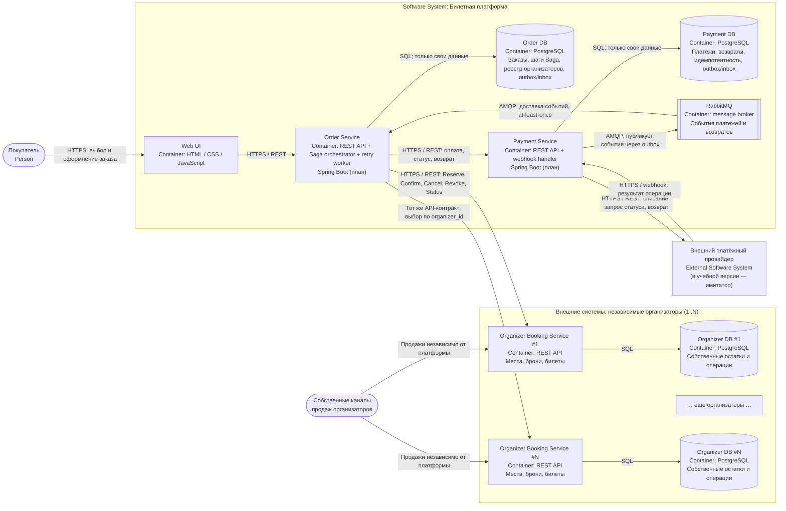

# 02. C4 — диаграмма уровня Container

**Проект:** Микросервисная платформа покупки билетов независимых организаторов с распределённым бронированием и компенсацией частично выполненных заказов.

**Уровень C4:** Container (контейнеры приложения, хранилища данных и инфраструктурные компоненты; не Docker-контейнеры в узком смысле).

## 1. Граница системы

Платформа позволяет оформить **один заказ из одной или нескольких позиций**: билеты могут относиться к одному мероприятию, нескольким мероприятиям одного организатора либо мероприятиям **любого числа независимых организаторов (1..N)**. Для пользователя покупка единая, но бронями и правом продажи каждого места владеет соответствующий организатор. Платформа не имеет доступа на запись в его БД.

**Внутри платформы:** веб-интерфейс, `Order Service`, `Payment Service`, их изолированные хранилища и брокер RabbitMQ.

**За пределами платформы:** автономные `Organizer Booking Service` (1..N) с собственными БД и каналами продаж, а также внешний платёжный провайдер.

## 2. C4 Container: диаграмма

## 3. Каталог контейнеров

| Контейнер | Размещение / технология | Назначение | Владеет данными |
|---|---|---|---|
| **Web UI** | Платформа: React, CSS, статическая раздача через веб-сервер | Составление заказа, запуск покупки, отображение статуса. Не хранит источник истины о бронях и оплате | Нет постоянной бизнес-БД |
| **Order Service** | Платформа; REST, Spring Boot | Создание и чтение заказов; подбор API организаторов из реестра; выполнение и восстановление Saga; подтверждения и компенсации | Только `Order DB` |
| **Order DB** | Платформа; PostgreSQL | Снимок состава и цены заказа; ссылки на внешние операции; состояние Saga; реестр организаторов; идемпотентность; outbox/inbox | `Order Service` |
| **Payment Service** | Платформа; REST, обработка webhook, Spring Boot | Исполнение и уточнение платежей, возвратов, разбор повторных уведомлений; публикация подтверждённых результатов | Только `Payment DB` |
| **Payment DB** | Платформа; PostgreSQL | Платёжные попытки, идентификаторы провайдера, статусы, возвраты, идемпотентность; outbox/inbox | `Payment Service` |
| **RabbitMQ** | Общая инфраструктура платформы; AMQP | Доставка событий `PaymentSucceeded`, `PaymentFailed`, `RefundSucceeded` и др.; очереди, подтверждения обработки и повторная доставка | Передаёт сообщения, но **не** является источником истины о деньгах или заказах |
| **Organizer Booking Service (1..N)** | Внешние независимо управляемые системы; единый REST-контракт | Управление событиями, местами/квотами, резервированием, подтверждением, отменой и аннулированием; обслуживание собственных каналов продаж | Только собственная `Organizer DB` |
| **Organizer DB (1..N)** | БД каждого организатора; PostgreSQL | Состояния мест, временных броней, выпущенных билетов, локальная идемпотентность и конкурентный контроль | Конкретный организатор |
| **Платёжный провайдер** | Внешняя система | Фактически выполняет платёж и возврат, предоставляет API сверки и webhook | Собственный реестр денежных операций |

## 4. Синхронные связи (HTTP API)

| Инициатор → получатель | Пример действия | Зачем синхронный обмен |
|---|---|---|
| Покупатель через Web UI → Order Service | Создать заказ; узнать статус | Сразу получить `order_id`, затем отображать текущее состояние |
| Order Service → Organizer Booking Service по `organizer_id` | Получить актуальную цену/доступность; зарезервировать позиции; подтвердить; отменить; аннулировать; проверить статус | У каждого организатора остаётся окончательное решение о местах и билетах; платформе нужно знать результат конкретного шага |
| Order Service → Payment Service | Создать платёж; получить его статус; инициировать возврат | Управление жизненным циклом платежа не смешивается с жизненным циклом заказа |
| Payment Service → платёжный провайдер | Выполнить списание, проверить результат, выполнить возврат | Деньги обрабатываются внешней системой; результат может быть задержан или неизвестен на момент ответа |
| Платёжный провайдер → Payment Service | Webhook о платеже/возврате | Асинхронный по смыслу callback через HTTP, иногда повторный или запоздалый |

При таймауте сетевого вызова результат считается **неизвестным**, а не автоматически неуспешным. Для критических операций сохраняются постоянные `operation_id` и `idempotency_key`, и выполняется запрос статуса / безопасный повтор. В интеграции предусмотрены таймауты, ограниченные повторные попытки и последующие фоновые сверки.

## 5. Асинхронные связи (RabbitMQ)

Брокер применяется **внутри платформы**, прежде всего между `Payment Service` и `Order Service`. Внешние организаторы не обязаны подключаться к RabbitMQ: они взаимодействуют со своим клиентом — платформой — через версионируемый HTTP API.

| Издатель | Событие (предварительное имя) | Подписчик | Реакция |
|---|---|---|---|
| Payment Service | `PaymentSucceeded` | Order Service | Зафиксировать факт оплаты и перейти к подтверждению всех броней |
| Payment Service | `PaymentFailed` | Order Service | Запустить компенсацию временных броней, если отказ окончательный |
| Payment Service | `RefundSucceeded` | Order Service | Отметить денежную компенсацию подтверждённой |
| Payment Service | `RefundFailed` | Order Service | Не закрывать компенсацию; выполнить сверку и дальнейшие повторы / эскалацию |

**Гарантия доставки:** at-least-once (сообщение может прийти несколько раз). Для защиты от потерь применяется **transactional outbox** у издателя: изменение платёжного состояния и запись исходящего сообщения выполняются в одной локальной транзакции PostgreSQL. Фоновый издатель отправляет сообщения из outbox в RabbitMQ, затем помечает опубликованными. Получатель использует `event_id` и inbox / журнал обработанных событий в своей БД, чтобы повторная доставка не запускала действие повторно. Порядок событий разных заказов не гарантируется; состояние заказа проверяется перед переходом.

## 6. Распределённый процесс и владение состояниями

**Оркестратор:** `Order Service`. Он сохраняет состояние Saga и шагов в `Order DB`, обрабатывает события оплаты, выполняет вызовы организаторов и повторяет отложенные операции встроенным фоновым обработчиком. 

**Основная последовательность:**

1. Сохранить `order_id`, позиции заказа и `organizer_id` каждой позиции; принять с клиента только идентификаторы и количества, актуальную цену и доступность проверять у владельца данных.
2. Сгруппировать позиции по организатору и создать **временные брони** у всех участников. В пределах одного организатора резервирование группы мест выполняется локально атомарно либо через отдельные отслеживаемые брони с локальной компенсацией.
3. Убедиться, что все брони активны и время действия позволяет безопасно продолжить; получить итоговую сумму по подтверждённым организаторами условиям.
4. Инициировать платёж через `Payment Service` с постоянным ключом идемпотентности и дождаться **подтверждённого** результата (событие или сверка статуса).
5. При подтверждённой оплате вызвать подтверждение броней у всех организаторов; сохранить внешний идентификатор каждого билета и результат каждой позиции.
6. Только когда оплата состоялась и **все** билеты подтверждены, перевести заказ в `COMPLETED` и сделать билеты доступными покупателю.
7. При невозможности завершить заказ начать компенсацию: отменить незавершённые брони, аннулировать уже подтверждённые билеты и, если платёж был успешным, оформить возврат через `Payment Service`. До подтверждения **всех** требуемых компенсаций оставлять заказ в `COMPENSATING`.

**Принцип «всё или ничего»:** это бизнес-гарантия **итогового** результата, а не обещание общей атомарной транзакции. При временной недоступности сторон допустимы промежуточные статусы `IN_PROGRESS`, `PAYMENT_PENDING`, `COMPENSATING`. 

## 7. Требования к автономным организаторам

Для подключения нового организатора платформа регистрирует `organizer_id`, защищённый базовый адрес API, версию контракта и учётные данные доступа в конфигурации/реестре `Order Service`. Никакой новой ветки кода «организатор A/B/C» не требуется.

Единый контракт организатора должен поддерживать как минимум:

- чтение мероприятия, цены и доступности (ответ справочный; место окончательно резервируется только сервером организатора);
- `Reserve(items, operation_id, idempotency_key)` → `reservation_id`, статус и `expires_at`;
- `Confirm(reservation_id, operation_id, idempotency_key)` → идентификаторы подтверждённых билетов;
- `Cancel(reservation_id, operation_id, idempotency_key)` → подтверждение освобождения временной брони;
- `Revoke(ticket_id, operation_id, idempotency_key)` → подтверждение аннулирования **ещё не использованного** билета;
- `GetOperationStatus(operation_id)` / `GetReservationStatus(reservation_id)` → восстановление состояния после потери ответа.

## 8. Изоляция данных и отказов

1. **Database per service:** `Order Service` и `Payment Service` имеют разные БД и разные учётные записи. `Order Service` не читает/изменяет таблицы платежей и организаторов напрямую. Каждый организатор владеет своей БД и может продолжать собственные продажи при недоступности платформы.
2. **Нет общей транзакции:** PostgreSQL-транзакция ограничена одной БД; сетевые вызовы к организаторам и провайдеру в неё не включаются. Распределённую согласованность обеспечивает Saga и компенсации.
3. **Конкурентный контроль:** только БД организатора атомарно фиксирует резерв свободного места/квоты. Проверка доступности в UI не является гарантией; конкурентный резерв может завершиться конфликтом.
4. **Независимая недоступность:** сбой организатора не делает базы других организаторов недоступными, но может задержать/сорвать конкретный составной заказ. Недоступный брокер не отменяет уже подтверждённый платёж — событие должно оставаться в outbox до публикации.
5. **Неизвестные результаты и повторные сообщения:** Payment Service сверяет реальный статус с провайдером, а Order Service — с организатором. Дублирование HTTP-команд/событий не должно дублировать деньги или билеты.
6. **Операционная безопасность:** защищённое HTTPS-взаимодействие, проверка webhook (подпись/секрет), авторизация между сервисами, хранение секретов вне документации, корреляционные идентификаторы `order_id`, `saga_id`, `operation_id` для журналов и трассировки.
