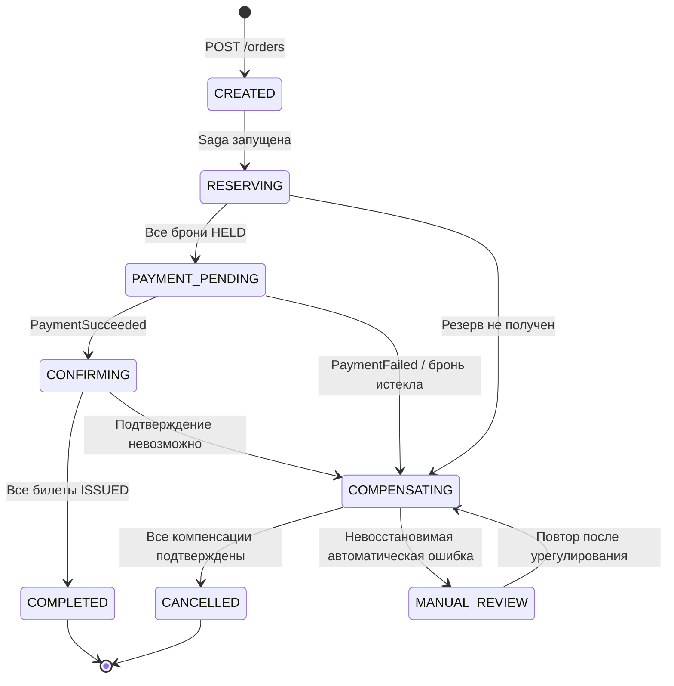

# 04. Главный процесс — Saga оформления составного заказа

**Проект:** Микросервисная платформа покупки билетов независимых организаторов с распределённым бронированием и компенсацией частично выполненных заказов.

## 1. Сценарии

| Файл | Сценарий | Результат |
|---|---|---|
| [`success.md`](success.md) | Все организаторы зарезервировали и подтвердили места, провайдер подтвердил оплату | `COMPLETED`, покупатель получает весь комплект |
| [`failure-seat-conflict.md`](failure-seat-conflict.md) | После резерва у А организатор Б вернул `409 SEAT_UNAVAILABLE` | Отмена всех предыдущих резервов; `CANCELLED`, списания не было |
| [`failure-payment.md`](failure-payment.md) | Провайдер списал деньги, но его HTTP-ответ потерялся | Сверка по прежнему `operation_id`, без повторного списания; продолжение Saga после достоверного результата |
| [`failure-ticket.md`](failure-ticket.md) | После оплаты А подтвердил билеты, а Б отказал из-за истечения брони | Revoke билетов А, Cancel/EXPIRED прочих резервов, **полный** Refund; `CANCELLED` только после подтверждений |

В примерах **А и Б — любые два из 1..N независимых организаторов**, а не ограничение системы. При одном организаторе цикл резервирования и подтверждения выполняется один раз. Если в заказе много мероприятий одного организатора, их места объединяются в **один атомарный резерв для этого организатора**.

## 2. Кто участвует

- **Покупатель / Web UI:** создаёт заказ (`POST /orders`) и опрашивает `GET /orders/{orderId}`. Ответ `202` подтверждает только приём, **не покупку**.
- **Order Service:** координирует Saga, хранит состав заказа, цену по резервам, `reservation_id`, `payment_id`, неизменные `operation_id` и результаты шагов.
- **Order DB:** единственный источник истины для состояния заказа, журнала Saga и inbox обработанных сообщений.
- **Organizer Booking Service (1..N):** независимый внешний источник истины по местам и билетам; сохраняет локальную атомарность резервирования и проверяет конкуренцию со своими продажами.
- **Payment Service / Payment DB:** отслеживают платёж и возврат, делают сверку с провайдером; результат сохраняется вместе с записью в **transactional outbox**.
- **Платёжный провайдер:** отдельная внешняя система (в учебном стенде — имитатор); реальный результат списания и возврата определяется им.
- **RabbitMQ:** передаёт проверенные платёжные события с доставкой `at-least-once` (повторы допустимы).

## 3. Бизнес-инварианты

1. **Весь комплект или компенсация.** `COMPLETED` допустим только при проверенном `PaymentSucceeded` и подтверждённых билетах **на все** заказанные места. Покупатель видит `confirmed_ticket_id` только в `COMPLETED`.
2. **Чужие остатки принадлежат организатору.** Сервис заказов никогда не изменяет таблицы мест, брони и билетов в чужих базах. Разные организаторы могут одновременно продавать через собственные каналы.
3. **Нельзя задвоить финансовую и ресурсную операции.** Любая команда имеет стабильные `operation_id` и `Idempotency-Key` (UUID). При таймауте сначала сверяем операцию; возможный повтор использует **те же** идентификаторы и тот же payload.
4. **Неизвестное состояние — не отказ.** Таймаут, `503` и потеря ответа не дают оснований считать резерв/платёж отменёнными. Журналируем неопределённость и восстанавливаем результат.
5. **Локальная атомарность.** Каждый организатор атомарно резервирует все места, переданные ему одним `POST /reservations`; межорганизаторской транзакции нет.
6. **Брони ограничены по времени.** Каждый резерв имеет `expires_at`. До оплаты Order Service проверяет запас времени. Учебное значение `requested_hold_seconds = 900`, поддерживаемое организатором либо отвергаемое с `HOLD_UNSUPPORTED`.
7. **Компенсация проверяется по результатам.** `CANCELLED` допускается, когда все удержанные места отменены или достоверно истекли, все подтверждённые билеты `REVOKED`, а при успешном списании подтверждён **полный** возврат. Пока это не доказано — `COMPENSATING` или `MANUAL_REVIEW`.
8. **Заказ и платежи не зависят от скорости RabbitMQ.** Outbox + Publisher Confirms и Inbox защищают от потери и повторного применения событий; проверка `GET` и фоновая сверка служат механизмом восстановления.

## 4. Машина состояний заказа

`PAYMENT_PENDING` включает неопределённый результат обращения к платёжному провайдеру. Решение о платеже принимается **только по проверенному статусу**, а не по таймауту. `MANUAL_REVIEW` не означает успешную отмену; он фиксирует необходимость урегулирования и допускает возвращение в `COMPENSATING`.

## 5. Соответствие контрактам из `03-contracts/`

| Действие на схемах | HTTP / событие | Где определено |
|---|---|---|
| Создать / проверить заказ | `POST /orders`, `GET /orders/{orderId}` | `order-api.openapi.yaml` |
| Создать атомарную бронь у выбранного организатора | `POST /reservations` | `organizer-api.openapi.yaml` |
| Проверить резерв или результат команды | `GET /reservations/{reservationId}`, `GET /operations/{operationId}` | `organizer-api.openapi.yaml` |
| Подтвердить / отменить резерв | `POST /reservations/{reservationId}/confirm` или `/cancel` | `organizer-api.openapi.yaml` |
| Аннулировать каждый выданный билет | `POST /tickets/{ticketId}/revoke` | `organizer-api.openapi.yaml` |
| Начать / сверить платёж | `POST /payments`, `GET /payments/by-operation/{operationId}` | `payment-api.openapi.yaml` |
| Списать / сверить у провайдера | `POST /charges`, `GET /charges/by-operation/{operationId}` | `provider-api.openapi.yaml` |
| Запросить / сверить полный возврат | `POST /payments/{paymentId}/refunds`, `GET /refunds/by-operation/{operationId}` | `payment-api.openapi.yaml` |
| Результаты списаний и возвратов | `PaymentSucceeded`, `PaymentFailed`, `RefundSucceeded`, `RefundFailed` | `platform-events.asyncapi.yaml` |

На диаграммах запись `Idempotency-Key = K_*` означает **HTTP-заголовок**, а `operation_id = OP_*` — поле тела команды. Каждый такой символ означает один стабильный UUID в рамках одного шага Saga. Для повторов нельзя создавать новое значение.

## 6. Правила повтора и порядок компенсации

- После **неопределённого исхода** `POST` у организатора Order Service использует `GET /operations/{operationId}`; если данных недостаточно, повторяет ту же команду с тем же `operation_id`/`Idempotency-Key`. Ответ `404` сам по себе не разрешает отправку новой логической операции с новым ключом.
- Payment Service при неизвестном исходе обращается к `GET /charges/by-operation/{operationId}` у провайдера. Верифицированный webhook также может восстановить результат. Повторная попытка списания с **другим** ключом запрещена.
- При отказе до оплаты компенсируются известные HELD-брони. При отказе **после** оплаты сначала надёжно аннулируются выпущенные билеты (каждый `ticket_id`), отменяются/проверяются ещё удерживаемые резервы и инициируется **один** полный возврат.
- При `503`, таймауте или неизвестном результате компенсация остаётся незавершённой. Фоновый работник продолжает сверку и безопасные повторы. `RefundFailed` требует расследования и дальнейшей сверки, а не смены статуса на `CANCELLED`.
- Если `Revoke` вернул `409 TICKET_ALREADY_USED`, ситуация не может автоматически считаться отменённой. Система переводит заказ в `MANUAL_REVIEW` с фиксацией всех выполненных действий.
