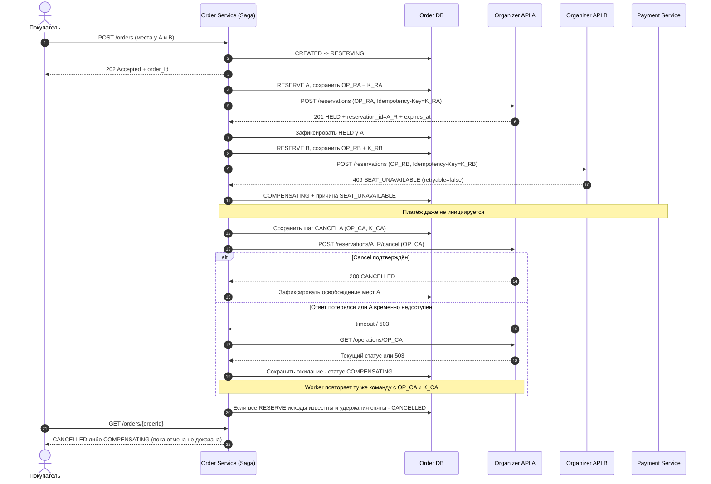

# 04.2. Сбой №1: один организатор забронировал места, следующий отказал

**Пример:** в заказе несколько мероприятий. Организатор А удержал все свои места (`HELD`), но организатор Б вернул `409 SEAT_UNAVAILABLE` из-за продажи места через собственный канал. Отказ является **достоверным**, а не таймаутом. Для N организаторов компенсируются **все** ранее успешные брони, не только А.

## Компенсация

1. Прервать дальнейшее бронирование и не вызывать `POST /payments`.
2. Перевести заказ в `COMPENSATING`, зафиксировать уже достигнутые результаты по каждому организатору.
3. Отменить каждую ранее подтверждённую временную бронь с помощью `POST /reservations/{reservationId}/cancel` и **стабильного** `operation_id`.
4. При неизвестном результате отмены проверить `GET /operations/{operationId}`; разрешены только идемпотентные повторы той же операции.
5. Если бронь успела истечь, подтвердить её статус `EXPIRED` через API организатора. Только после подтверждения освобождения всех ресурсов поставить `CANCELLED`.

**Инвариант:** отказ `409 SEAT_UNAVAILABLE` от одного участника **не означает** отказ от всех ранее успешных резервов автоматически — эти резервы надо компенсировать явно. Денежного возврата нет, поскольку платёж не начинался.

**Отдельный случай:** если ответ Б **не пришёл вовсе**, это не доказанный отказ. Пока исход исходной команды `OP_RB` не выяснен через `GET /operations/OP_RB` или повтор с тем же ключом, заказ нельзя считать полностью отменённым: у Б могла возникнуть активная бронь.
